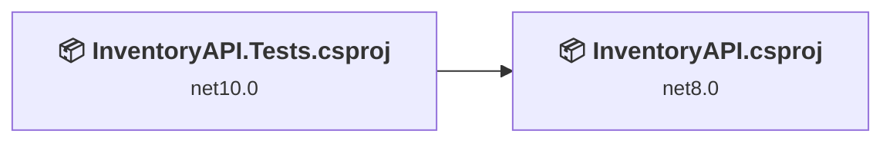
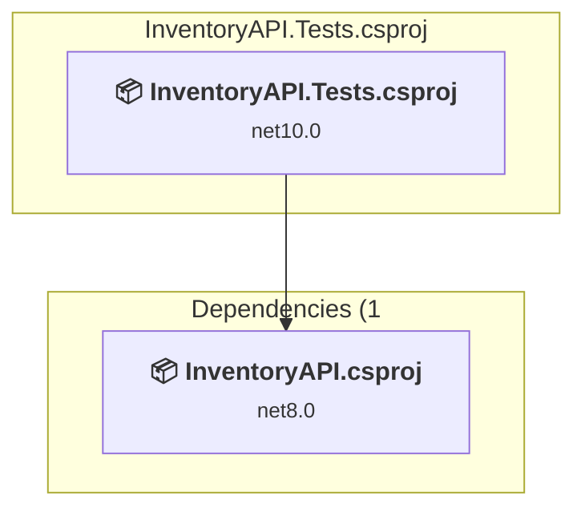
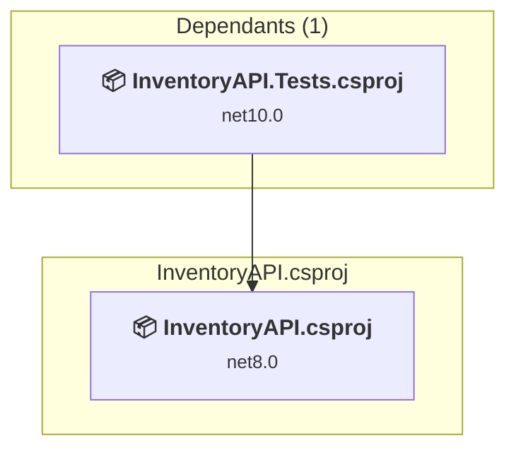

# Projects and dependencies analysis

This document provides a comprehensive overview of the projects and their dependencies in the context of upgrading to .NETCoreApp,Version=v10.0.

## Table of Contents

- [Executive Summary](#executive-Summary)
  - [Highlevel Metrics](#highlevel-metrics)
  - [Projects Compatibility](#projects-compatibility)
  - [Package Compatibility](#package-compatibility)
  - [API Compatibility](#api-compatibility)
  - [Binding Redirect Configuration](#binding-redirect-configuration)
- [Aggregate NuGet packages details](#aggregate-nuget-packages-details)
- [Top API Migration Challenges](#top-api-migration-challenges)
  - [Technologies and Features](#technologies-and-features)
  - [Most Frequent API Issues](#most-frequent-api-issues)
- [Projects Relationship Graph](#projects-relationship-graph)
- [Project Details](#project-details)

  - [InventoryAPI.Tests\InventoryAPI.Tests.csproj](#inventoryapitestsinventoryapitestscsproj)
  - [InventoryAPI\InventoryAPI.csproj](#inventoryapiinventoryapicsproj)

## Executive Summary

### Highlevel Metrics

| Metric | Count | Status |
| :--- | :---: | :--- |
| Total Projects | 2 | 1 require upgrade |
| Total NuGet Packages | 18 | 5 need upgrade |
| Total Code Files | 57 |  |
| Total Code Files with Incidents | 3 |  |
| Total Lines of Code | 2468 |  |
| Total Number of Issues | 16 |  |
| Estimated LOC to modify | 10+ | at least 0.4% of codebase |

### Projects Compatibility

| Project | Target Framework | Difficulty | Package Issues | API Issues | Binding Issues | Est. LOC Impact | Description |
| :--- | :---: | :---: | :---: | :---: | :---: | :---: | :--- |
| [InventoryAPI.Tests\InventoryAPI.Tests.csproj](#inventoryapitestsinventoryapitestscsproj) | net10.0 | ✅ None | 0 | 0 | 0 |  | DotNetCoreApp, Sdk Style = True |
| [InventoryAPI\InventoryAPI.csproj](#inventoryapiinventoryapicsproj) | net8.0 | 🟢 Low | 5 | 10 | 0 | 10+ | AspNetCore, Sdk Style = True |

### Package Compatibility

| Status | Count | Percentage |
| :--- | :---: | :---: |
| ✅ Compatible | 13 | 72.2% |
| ⚠️ Incompatible | 2 | 11.1% |
| 🔄 Upgrade Recommended | 3 | 16.7% |
| ***Total NuGet Packages*** | ***18*** | ***100%*** |

### API Compatibility

| Category | Count | Impact |
| :--- | :---: | :--- |
| 🔴 Binary Incompatible | 7 | High - Require code changes |
| 🟡 Source Incompatible | 3 | Medium - Needs re-compilation and potential conflicting API error fixing |
| 🔵 Behavioral change | 0 | Low - Behavioral changes that may require testing at runtime |
| ✅ Compatible | 1467 |  |
| ***Total APIs Analyzed*** | ***1477*** |  |

## Aggregate NuGet packages details

| Package | Current Version | Suggested Version | Projects | Description |
| :--- | :---: | :---: | :--- | :--- |
| coverlet.collector | 10.0.1 |  | [InventoryAPI.Tests.csproj](#inventoryapitestsinventoryapitestscsproj) | ✅Compatible |
| Dapper | 2.1.66 |  | [InventoryAPI.csproj](#inventoryapiinventoryapicsproj) | ✅Compatible |
| FluentValidation | 11.3.1 |  | [InventoryAPI.csproj](#inventoryapiinventoryapicsproj) | ✅Compatible |
| MediatR | 11.1.0 |  | [InventoryAPI.csproj](#inventoryapiinventoryapicsproj) | ✅Compatible |
| MediatR.Extensions.Microsoft.DependencyInjection | 11.1.0 |  | [InventoryAPI.csproj](#inventoryapiinventoryapicsproj) | ⚠️NuGet package is deprecated |
| Microsoft.ApplicationInsights.AspNetCore | 2.21.0 |  | [InventoryAPI.csproj](#inventoryapiinventoryapicsproj) | ⚠️NuGet package is deprecated |
| Microsoft.AspNetCore.Authentication.JwtBearer | 8.0.15 | 10.0.12 | [InventoryAPI.csproj](#inventoryapiinventoryapicsproj) | NuGet package upgrade is recommended |
| Microsoft.Data.SqlClient | 6.0.1 |  | [InventoryAPI.csproj](#inventoryapiinventoryapicsproj) | ✅Compatible |
| Microsoft.EntityFrameworkCore | 8.0.29 | 10.0.12 | [InventoryAPI.csproj](#inventoryapiinventoryapicsproj) | NuGet package upgrade is recommended |
| Microsoft.Extensions.Identity.Core | 9.0.4 | 10.0.12 | [InventoryAPI.csproj](#inventoryapiinventoryapicsproj) | NuGet package upgrade is recommended |
| Microsoft.NET.Test.Sdk | 17.14.1 |  | [InventoryAPI.Tests.csproj](#inventoryapitestsinventoryapitestscsproj) | ✅Compatible |
| Moq | 4.20.72 |  | [InventoryAPI.Tests.csproj](#inventoryapitestsinventoryapitestscsproj) | ✅Compatible |
| Serilog.AspNetCore | 7.0.0 |  | [InventoryAPI.csproj](#inventoryapiinventoryapicsproj) | ✅Compatible |
| Serilog.Sinks.Console | 4.1.0 |  | [InventoryAPI.csproj](#inventoryapiinventoryapicsproj) | ✅Compatible |
| Serilog.Sinks.Seq | 6.0.0 |  | [InventoryAPI.csproj](#inventoryapiinventoryapicsproj) | ✅Compatible |
| Swashbuckle.AspNetCore | 6.4.0 |  | [InventoryAPI.csproj](#inventoryapiinventoryapicsproj) | ✅Compatible |
| xunit | 2.9.3 |  | [InventoryAPI.Tests.csproj](#inventoryapitestsinventoryapitestscsproj) | ✅Compatible |
| xunit.runner.visualstudio | 3.1.4 |  | [InventoryAPI.Tests.csproj](#inventoryapitestsinventoryapitestscsproj) | ✅Compatible |

## Top API Migration Challenges

### Technologies and Features

| Technology | Issues | Percentage | Migration Path |
| :--- | :---: | :---: | :--- |
| IdentityModel & Claims-based Security | 6 | 60.0% | Windows Identity Foundation (WIF), SAML, and claims-based authentication APIs that have been replaced by modern identity libraries. WIF was the original identity framework for .NET Framework. Migrate to Microsoft.IdentityModel.* packages (modern identity stack). |

### Most Frequent API Issues

| API | Count | Percentage | Category |
| :--- | :---: | :---: | :--- |
| P:System.IdentityModel.Tokens.Jwt.JwtSecurityToken.ValidTo | 1 | 10.0% | Binary Incompatible |
| T:System.IdentityModel.Tokens.Jwt.JwtSecurityTokenHandler | 1 | 10.0% | Binary Incompatible |
| M:System.IdentityModel.Tokens.Jwt.JwtSecurityTokenHandler.#ctor | 1 | 10.0% | Binary Incompatible |
| M:System.IdentityModel.Tokens.Jwt.JwtSecurityTokenHandler.WriteToken(Microsoft.IdentityModel.Tokens.SecurityToken) | 1 | 10.0% | Binary Incompatible |
| T:System.IdentityModel.Tokens.Jwt.JwtSecurityToken | 1 | 10.0% | Binary Incompatible |
| M:System.IdentityModel.Tokens.Jwt.JwtSecurityToken.#ctor(System.String,System.String,System.Collections.Generic.IEnumerable{System.Security.Claims.Claim},System.Nullable{System.DateTime},System.Nullable{System.DateTime},Microsoft.IdentityModel.Tokens.SigningCredentials) | 1 | 10.0% | Binary Incompatible |
| P:Microsoft.AspNetCore.Authentication.JwtBearer.JwtBearerOptions.TokenValidationParameters | 1 | 10.0% | Source Incompatible |
| T:Microsoft.Extensions.DependencyInjection.JwtBearerExtensions | 1 | 10.0% | Source Incompatible |
| M:Microsoft.Extensions.DependencyInjection.JwtBearerExtensions.AddJwtBearer(Microsoft.AspNetCore.Authentication.AuthenticationBuilder,System.String,System.Action{Microsoft.AspNetCore.Authentication.JwtBearer.JwtBearerOptions}) | 1 | 10.0% | Source Incompatible |
| M:Microsoft.Extensions.Configuration.ConfigurationBinder.GetValue''1(Microsoft.Extensions.Configuration.IConfiguration,System.String) | 1 | 10.0% | Binary Incompatible |

## Projects Relationship Graph

Legend:
📦 SDK-style project
⚙️ Classic project

## Project Details

### InventoryAPI.Tests\InventoryAPI.Tests.csproj

#### Project Info

- **Current Target Framework:** net10.0✅
- **SDK-style**: True
- **Project Kind:** DotNetCoreApp
- **Dependencies**: 1
- **Dependants**: 0
- **Number of Files**: 10
- **Lines of Code**: 976
- **Estimated LOC to modify**: 0+ (at least 0.0% of the project)

#### Dependency Graph

Legend:
📦 SDK-style project
⚙️ Classic project

### API Compatibility

| Category | Count | Impact |
| :--- | :---: | :--- |
| 🔴 Binary Incompatible | 0 | High - Require code changes |
| 🟡 Source Incompatible | 0 | Medium - Needs re-compilation and potential conflicting API error fixing |
| 🔵 Behavioral change | 0 | Low - Behavioral changes that may require testing at runtime |
| ✅ Compatible | 0 |  |
| ***Total APIs Analyzed*** | ***0*** |  |

### InventoryAPI\InventoryAPI.csproj

#### Project Info

- **Current Target Framework:** net8.0
- **Proposed Target Framework:** net10.0
- **SDK-style**: True
- **Project Kind:** AspNetCore
- **Dependencies**: 0
- **Dependants**: 1
- **Number of Files**: 55
- **Number of Files with Incidents**: 3
- **Lines of Code**: 1492
- **Estimated LOC to modify**: 10+ (at least 0.7% of the project)

#### Dependency Graph

Legend:
📦 SDK-style project
⚙️ Classic project

### API Compatibility

| Category | Count | Impact |
| :--- | :---: | :--- |
| 🔴 Binary Incompatible | 7 | High - Require code changes |
| 🟡 Source Incompatible | 3 | Medium - Needs re-compilation and potential conflicting API error fixing |
| 🔵 Behavioral change | 0 | Low - Behavioral changes that may require testing at runtime |
| ✅ Compatible | 1467 |  |
| ***Total APIs Analyzed*** | ***1477*** |  |

#### Project Technologies and Features

| Technology | Issues | Percentage | Migration Path |
| :--- | :---: | :---: | :--- |
| IdentityModel & Claims-based Security | 6 | 60.0% | Windows Identity Foundation (WIF), SAML, and claims-based authentication APIs that have been replaced by modern identity libraries. WIF was the original identity framework for .NET Framework. Migrate to Microsoft.IdentityModel.* packages (modern identity stack). |

